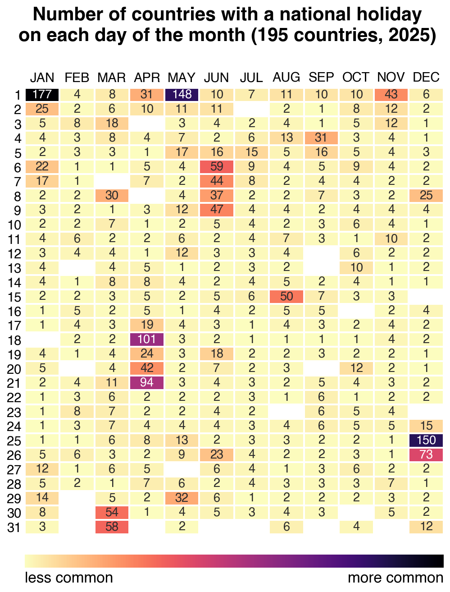

# National Holidays Heatmap (2025)

A calendar heatmap showing how many countries observe a **national public holiday** on each day of 2025.

The data consists of **195 countries** (actually, 193 UN members + Holy See & Palestine).



Darker cells mean more countries share that holiday. 

## Run

```bash
pip install holidays pandas numpy seaborn matplotlib
python holidays_heatmap_2025.py
```

Outputs `holidays_heatmap_2025.png`.

## Notes

- Data from [`python-holidays`](https://github.com/vacanza/holidays) v0.83 — national (non-regional) holidays only.
- Ukraine contributes no holidays for 2025 (martial law), so 194 of the 195 countries actually appear in the data.